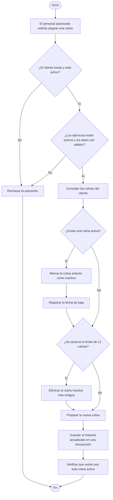
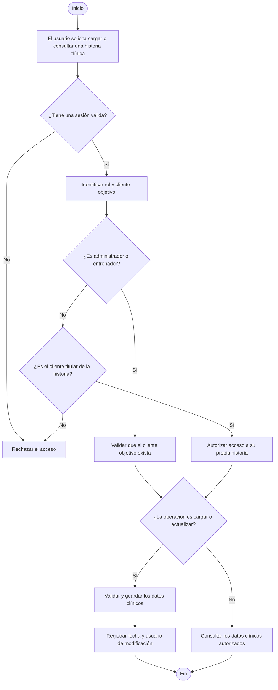
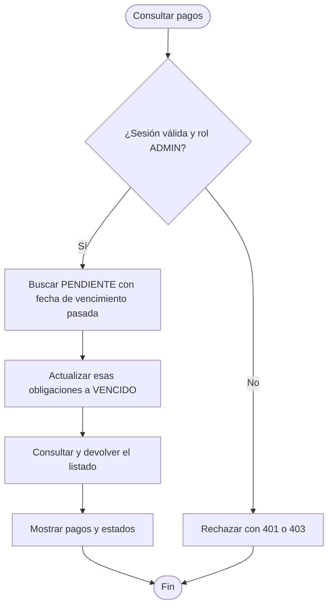

# Diagramas de Actividad — Gym Manager

## 1. Asignación de rutina a un cliente

**Caso de uso:** CU-07 — Asignar rutina a cliente.

**Actor principal:** administrador o entrenador autenticado.

El diagrama representa las validaciones del cliente, la vigencia de la rutina anterior y el límite de rutinas conservadas.

[Ver diagrama en PNG](diagramas/actividad_01_asignacion_rutina.png)

**Resultado esperado:** el cliente queda con una nueva rutina activa y se conserva el historial dentro del límite establecido por RN-04.

La rutina activa nunca debe eliminarse como parte de la limpieza del historial. La preparación del historial y su persistencia forman parte de la asignación transaccional; los pasos intermedios no representan escrituras independientes. Los flujos se presentan como bloques Mermaid, visibles directamente en GitHub.

## 2. Carga y consulta de historia clínica

**Casos de uso:** CU-09 — Cargar historia clínica; CU-10 — Consultar historia clínica.

**Actores:** cliente con cuenta, administrador y entrenador.

El acceso depende del rol del usuario y, cuando actúa un cliente, de que la historia corresponda a su propio registro.

[Ver diagrama en PNG](diagramas/actividad_02_historia_clinica.png)

**Resultado esperado:** solo los actores autorizados pueden consultar o modificar la historia clínica. Un cliente no puede acceder a la historia de otro cliente.

## 3. Detección de cuotas vencidas al consultar

**Caso de uso:** CU-14 — Detectar cuotas vencidas.

**Actor:** administrador autenticado. El servidor evalúa los pendientes al consultar pagos; no existe una tarea periódica.

[Ver diagrama en PNG](diagramas/actividad_03_cuotas_vencida.png)

**Resultado esperado:** los pendientes vencidos se identifican al consultar, de acuerdo con RN-11. Los pagos ya cobrados no se convierten en deuda. Los indicadores de próximos vencimientos del inicio son una consulta distinta, contemplada en CU-15 y RN-13.
