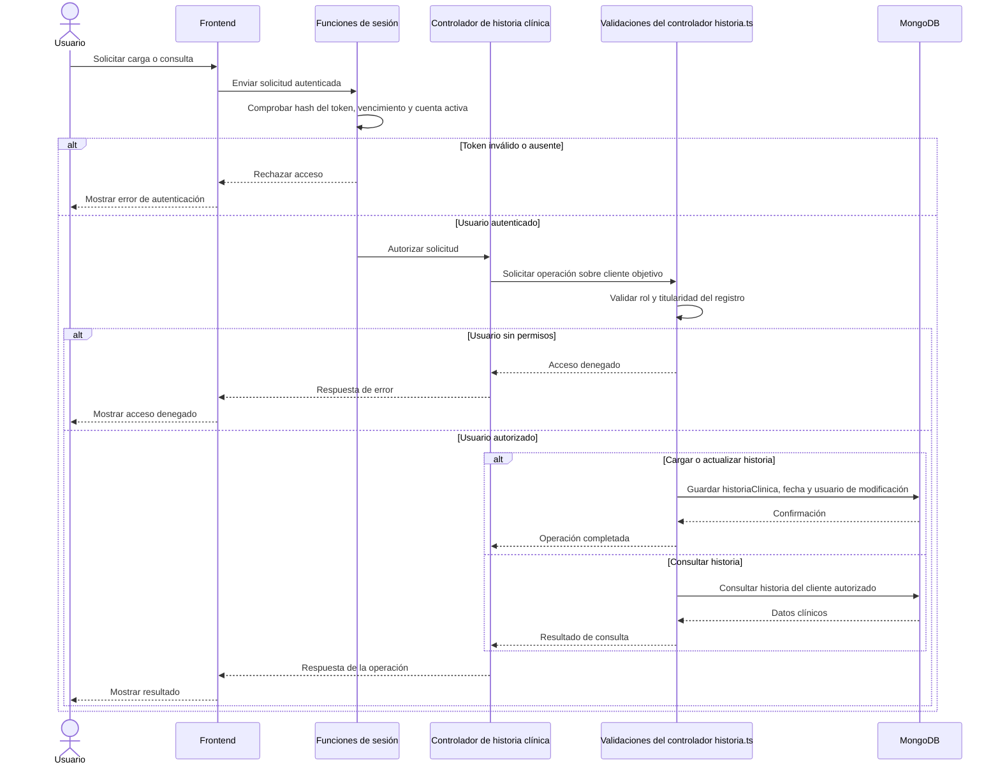
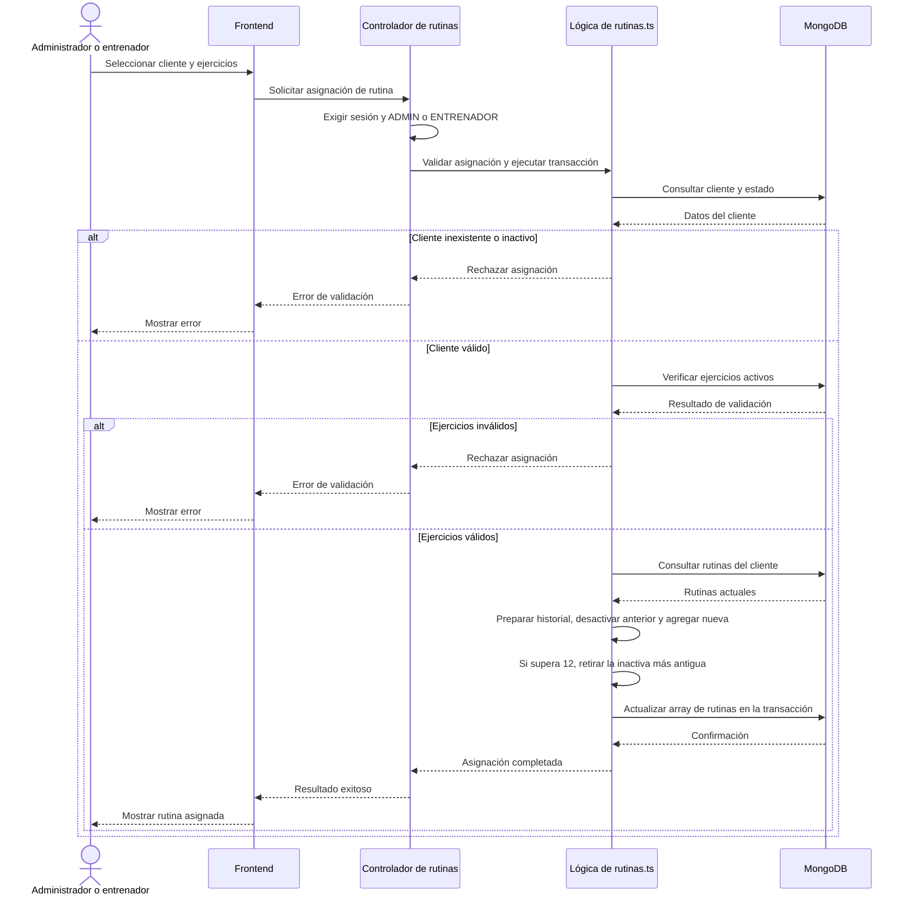
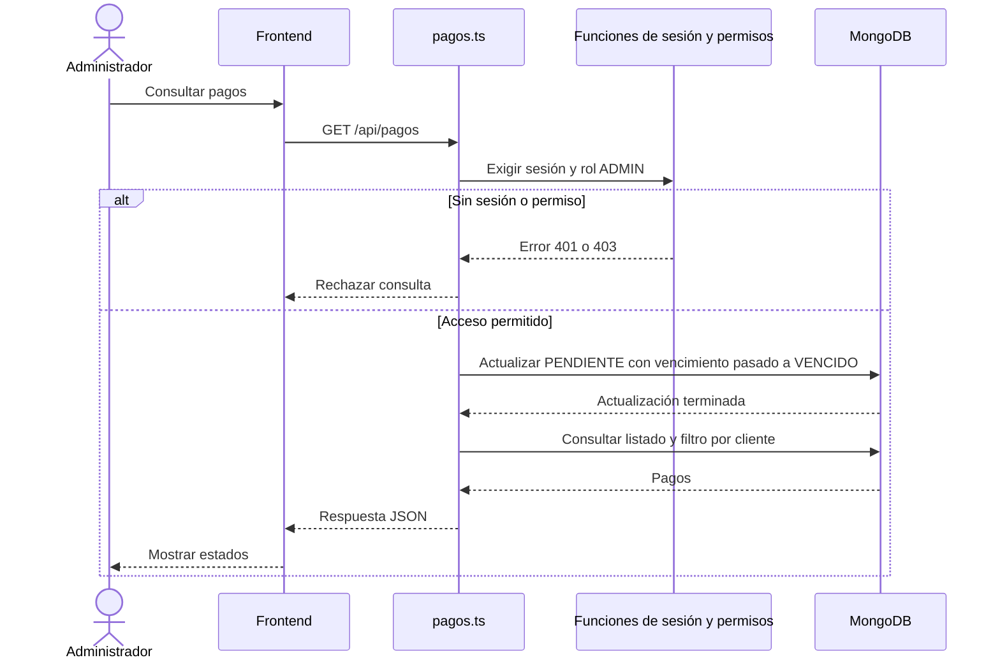

# Diagramas de Secuencia — Gym Manager

## 1. Carga y consulta de historia clínica

**Casos de uso:** CU-09 y CU-10.

El diagrama representa el recorrido desde la solicitud del usuario hasta la autorización y el acceso a los datos. Los participantes representan el frontend, las funciones de sesión, el controlador y MongoDB; no implican clases adicionales. Los diagramas se presentan como bloques Mermaid, visibles directamente en GitHub.

[Ver diagrama en PNG](diagramas/secuencia_01_historia_clinica.png)

**Consideraciones:**

- La autenticación no reemplaza la validación de titularidad de la historia clínica.
- El administrador y el entrenador pueden operar sobre clientes autorizados por las reglas del proyecto.
- Un cliente con cuenta solo puede acceder a su propia historia clínica.
- La historia clínica es opcional, de acuerdo con RN-05.

## 2. Asignación de rutina

**Caso de uso:** CU-07 — Asignar rutina a cliente.

El flujo contempla las validaciones previas, la desactivación de la rutina anterior y la aplicación del límite de historial.

[Ver diagrama en PNG](diagramas/secuencia_02_asignacion_rutina.png)

**Consideraciones:**

- La operación debe garantizar que no queden dos rutinas activas para el mismo cliente.
- Solo se elimina físicamente la rutina inactiva más antigua cuando se alcanzó el límite de 12.
- Las modificaciones del historial se preparan en memoria y se guardan en una actualización dentro de la transacción de MongoDB.

## 3. Detección de cuotas vencidas

**Caso de uso:** CU-14 — Detectar cuotas vencidas.

La consulta administrativa de pagos actualiza los pendientes vencidos antes de devolver el listado. No existe un programador periódico en esta versión.

[Ver diagrama en PNG](diagramas/secuencia_03_cuotas_vencidas.png)

**Consideraciones:**

- Una obligación PAGADO conserva su estado aunque pase su fecha de vencimiento.
- Registrar una cuota nueva no cancela una obligación anterior.
- El resumen consulta vencidos y próximos vencimientos para sus indicadores; no ejecuta un proceso periódico ni genera cuotas nuevas.
