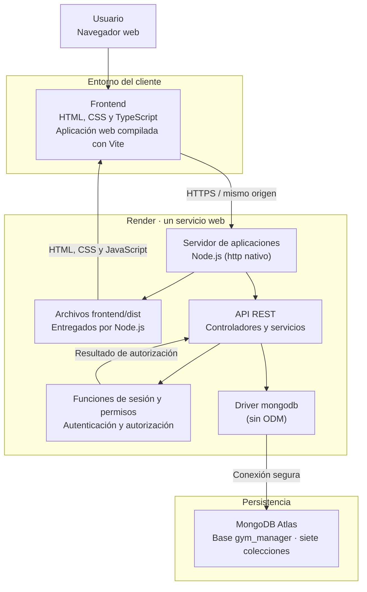

# Diagrama de Despliegue — Gym Manager

## 1. Objetivo

El diagrama representa la demostración en Render y su conexión con MongoDB Atlas. El equipo selecciona manualmente las versiones a desplegar. La aplicación está publicada en [gymmanager-grupo-101.onrender.com](https://gymmanager-grupo-101.onrender.com/).

## 2. Diagrama

[Ver diagrama en PNG](diagramas/despliegue.png)

## 3. Nodos y responsabilidades

| Nodo | Responsabilidad |
|---|---|
| Navegador web | Permite al usuario utilizar el sistema. |
| Archivos del frontend | `frontend/dist` contiene páginas y recursos entregados por el backend en Render. |
| Frontend | Presenta las pantallas y consume los endpoints de la API REST. |
| Servidor Node.js (http nativo) | Ejecuta la lógica del backend y expone los servicios del sistema. |
| Funciones de sesión y permisos | Gestiona autenticación y autorización según la configuración implementada. |
| Controladores y servicios REST | Procesan solicitudes, validan reglas de negocio y coordinan las operaciones. |
| Driver mongodb (sin ODM) | Facilita el acceso a los documentos almacenados. |
| MongoDB Atlas | Aloja la base de datos documental del sistema. |

## 4. Comunicaciones

- **Usuario → frontend:** acceso a la aplicación mediante navegador.
- **Frontend → backend:** solicitudes HTTP sobre HTTPS, con intercambio de datos en formato JSON.
- **Backend → base de datos:** acceso a MongoDB mediante una conexión configurada de forma segura.

## 5. Consideraciones de despliegue y seguridad

1. La demostración entrega páginas y API desde el mismo servicio y origen HTTPS. Durante el desarrollo se utiliza el proxy de Vite o el servidor conjunto.
2. Un despliegue con orígenes separados requeriría configurar expresamente la comunicación y las cookies.
3. La URI de Atlas y demás credenciales se configuran mediante variables de entorno privadas del backend.
4. El acceso a MongoDB Atlas se configura mediante autenticación y restricciones de red que deben comprobarse en el entorno.
5. El backend comprueba sesión, cuenta activa y permisos de cada operación. En Render se establece `NODE_ENV=production` para la cookie `Secure`.
6. El equipo selecciona manualmente la versión desplegada. La región y los parámetros operativos deben verificarse en el servicio.

El bloque Mermaid representa los componentes del despliegue y se visualiza directamente en GitHub.

## 6. Relación con la arquitectura

Este diagrama complementa `ARQUITECTURA.md`: representa dónde se ejecutan los componentes y cómo se comunican, mientras que el documento de arquitectura explica su organización y responsabilidades.
