## Diagrama UML del modelo NoSQL

El siguiente diagrama UML representa visualmente la estructura definida para el modelo NoSQL de **Gym Manager**. Su objetivo es facilitar la lectura de las colecciones, los documentos embebidos y las referencias entre ellos.

El diseño detallado y la definición de los campos se encuentran en `ESQUEMA_NOSQL.md`.

### Visualización

El bloque Mermaid representa el modelo documental y se visualiza directamente en GitHub. El detalle de tipos, opcionalidad e índices se encuentra en [ESQUEMA_NOSQL.md](ESQUEMA_NOSQL.md).

### Cómo leer el diagrama

* Las clases marcadas como `<<collection>>` representan las **colecciones principales de MongoDB**.
* Las clases marcadas como `<<embedded>>` representan **documentos embebidos** dentro de otra colección. No son colecciones independientes.
* Las relaciones con **rombo negro (`*--`)** representan composición y se utilizan para mostrar los documentos que forman parte de otro documento.
* Las relaciones con **líneas simples (`--`)** representan referencias entre documentos, generalmente mediante `ObjectId`.
* Las relaciones con **flecha (`-->` o `<--`)** permiten identificar el sentido de la referencia.
* Las multiplicidades (`1`, `0..1`, `0..*`, `1..*`, etc.) indican cuántos elementos pueden relacionarse entre sí.
* Las clases marcadas como `<<enumeration>>` representan **valores posibles de determinados campos** y no colecciones de MongoDB.
* Las relaciones punteadas (`..>`) indican que una colección utiliza una de estas enumeraciones como tipo de un campo.
* La relación `usuarios -- clientes` indica además que `clienteId` (en `usuarios`) y `usuarioId` (en `clientes`) son campos `UNIQUE`, lo que evita referencias duplicadas presentes; la aplicación mantiene además su reciprocidad (ver `ESQUEMA_NOSQL.md`, sección "Índices únicos").
* Las **notas** (`note for ...`) documentan reglas de negocio que no se pueden representar únicamente con cardinalidades (por ejemplo, que solo una rutina puede estar activa a la vez).

De esta forma, el diagrama permite distinguir visualmente entre:

1. **Colecciones principales** de MongoDB.
2. **Documentos embebidos** dentro de otras colecciones.
3. **Referencias mediante `ObjectId`** entre documentos.
4. **Enumeraciones** utilizadas para limitar los valores de determinados campos.

### Diagrama

[Ver diagrama en PNG](DIAGRAMA_UML.png)

```mermaid
classDiagram

    %% =====================================================
    %% COLECCIONES PRINCIPALES DE MONGODB
    %% =====================================================

    class usuarios {
        <<collection>>
        +ObjectId _id
        +String nombre
        +String apellido
        +String email
        +String passwordHash
        +Rol[] rol
        +ObjectId clienteId
        +Boolean activo
        +Date fechaCreacion
        +Date fechaModificacion
        +Date fechaBaja
    }

    class clientes {
        <<collection>>
        +ObjectId _id
        +String nombre
        +String apellido
        +String dni
        +Date fechaNacimiento
        +String telefono
        +String email
        +String direccion
        +ObjectId usuarioId
        +Boolean activo
        +Date fechaCreacion
        +Date fechaModificacion
        +Date fechaBaja
    }

    class ejercicios {
        <<collection>>
        +ObjectId _id
        +String codigo
        +String nombre
        +String descripcion
        +String grupoMuscular
        +Boolean activo
        +Date fechaCreacion
        +Date fechaModificacion
        +Date fechaBaja
    }

    class turnos {
        <<collection>>
        +ObjectId _id
        +String dia
        +String horaInicio
        +String horaFin
        +Int32 capacidad
        +ObjectId entrenadorId
        +ObjectId[] clientes
        +Boolean activo
        +String observaciones
    }

    class HistorialClientes {
        <<embedded>>
        +ObjectId clienteId
        +String accion
        +Date fecha
        +ObjectId usuarioId
    }

    class FranjaHoraria {
        <<embedded>>
        +String inicio
        +String fin
    }

    class Trabajo {
        <<embedded>>
        +ObjectId entrenadorId
        +String[] dias
    }

    class pagos {
        <<collection>>
        +ObjectId _id
        +ObjectId clienteId
        +TipoPago tipo
        +Decimal128 monto
        +Date fechaPago
        +Date fechaVencimiento
        +EstadoPago estado
        +String observaciones
        +ObjectId usuarioRegistroId
    }

    class configuracion {
        <<collection>>
        +ObjectId _id
        +Int32 capacidad
        +Date fechaModificacion
    }

    class sesiones {
        <<collection>>
        +ObjectId _id
        +ObjectId usuarioId
        +String tokenHash
        +Date fechaCreacion
        +Date fechaVencimiento
    }


    %% =====================================================
    %% DOCUMENTOS EMBEBIDOS
    %% =====================================================

    class Rutina {
        <<embedded>>
        +ObjectId _id
        +Date fechaAsignacion
        +ObjectId entrenadorId
        +String observaciones
        +Boolean activo
        +Date fechaCreacion
        +Date fechaModificacion
        +Date fechaBaja
    }

    class EjercicioRutina {
        <<embedded>>
        +ObjectId ejercicioId
        +Int32 series
        +Int32 repeticiones
        +Number peso
        +Int32 descanso
        +Int32 orden
        +String observaciones
    }

    class HistoriaClinica {
        <<embedded>>
        +String antecedentes
        +String lesiones
        +String observaciones
        +Date fechaActualizacion
        +ObjectId usuarioModificacionId
    }

    class ContactoEmergencia {
        <<embedded>>
        +String nombre
        +String telefono
        +String relacion
    }


    %% =====================================================
    %% ENUMERACIONES / VALORES POSIBLES
    %% =====================================================

    class Rol {
        <<enumeration>>
        ADMIN
        ENTRENADOR
        USUARIO
    }

    class TipoPago {
        <<enumeration>>
        INSCRIPCION
        CUOTA
    }

    class EstadoPago {
        <<enumeration>>
        PAGADO
        PENDIENTE
        VENCIDO
    }


    %% =====================================================
    %% ESTRUCTURA EMBEBIDA
    %% =====================================================

    clientes "1" *-- "0..12" Rutina : rutinas[]

    clientes "1" *-- "0..1" HistoriaClinica : historiaClinica

    clientes "1" *-- "0..1" ContactoEmergencia : contactoEmergencia

    Rutina "1" *-- "1..*" EjercicioRutina : ejercicios[]

    turnos "1" *-- "0..*" HistorialClientes : historialClientes[]

    configuracion "1" *-- "0..*" FranjaHoraria : franjas[]

    configuracion "1" *-- "0..*" Trabajo : trabajos[]


    %% =====================================================
    %% REFERENCIAS MEDIANTE OBJECTID
    %% =====================================================

    usuarios "0..1" -- "0..1" clientes : clienteId / usuarioId (ambos UNIQUE)

    clientes "1" <-- "0..*" pagos : clienteId

    usuarios "1" <-- "0..*" pagos : usuarioRegistroId

    usuarios "1" <-- "0..*" turnos : entrenadorId

    clientes "0..*" -- "0..*" turnos : clientes[]

    usuarios "1" <-- "0..*" HistorialClientes : usuarioId

    usuarios "1" <-- "0..*" Rutina : entrenadorId

    ejercicios "1" <-- "0..*" EjercicioRutina : ejercicioId

    usuarios "1" <-- "0..*" sesiones : usuarioId

    usuarios "0..1" <-- "0..*" HistoriaClinica : usuarioModificacionId

    usuarios "1" <-- "0..*" Trabajo : entrenadorId


    %% =====================================================
    %% ENUMERACIONES UTILIZADAS POR LOS CAMPOS
    %% =====================================================

    usuarios ..> Rol : rol

    pagos ..> TipoPago : tipo

    pagos ..> EstadoPago : estado


    %% =====================================================
    %% NOTAS DE REGLAS DE NEGOCIO (no representables como cardinalidad)
    %% =====================================================

    note for Rutina "Regla de negocio: en el arreglo rutinas[] de un mismo cliente, solo una Rutina puede tener activo = true a la vez (la vigente). El historial se limita a 12 rutinas por cliente; al superar ese límite se elimina físicamente la más antigua entre las inactivas."

    note for usuarios "rol siempre se almacena como arreglo (Rol[]), incluso con un solo valor, para soportar cuentas con mas de un rol a la vez (por ejemplo ADMIN y ENTRENADOR). Una cuenta ADMIN + ENTRENADOR se trata como Administrador: no aplican sobre ella las restricciones propias del Entrenador."

    note for pagos "monto utiliza BSON Decimal128 conforme al modelo de Atlas y conserva precision monetaria."
```

### Tipos, opcionalidad y alcance

El diagrama representa siete colecciones y sus documentos embebidos. `Rutina`, `EjercicioRutina`, `HistoriaClinica`, `ContactoEmergencia`, `HistorialClientes`, `FranjaHoraria` y `Trabajo` se almacenan dentro de otros documentos. Las enumeraciones expresan valores permitidos.

Las referencias entre cuenta y ficha son opcionales y únicas con índices sparse. Cuando no hay vínculo, se omiten en persistencia. Las fechas de baja pueden estar ausentes o ser nulas en registros anteriores. El validador de pagos compartido exige `fechaPago` y `fechaVencimiento` como BSON Date, sin valores nulos ni omisiones. La distinción entre esa restricción y el comportamiento de obligaciones pendientes se explica en [ESQUEMA_NOSQL.md](ESQUEMA_NOSQL.md).

`usuarioModificacionId` identifica la última modificación clínica cuando existe. La cardinalidad opcional permite consultar información anterior sin autor registrado. Los metadatos de ciclos descritos en el esquema no generan obligaciones por sí mismos.

El esquema define los tipos y restricciones del modelo; el diagrama complementa esa definición mediante sus relaciones y cardinalidades.
