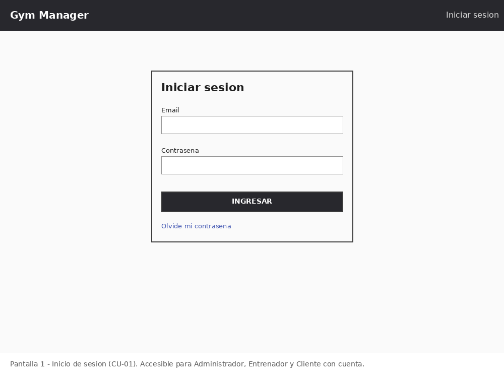
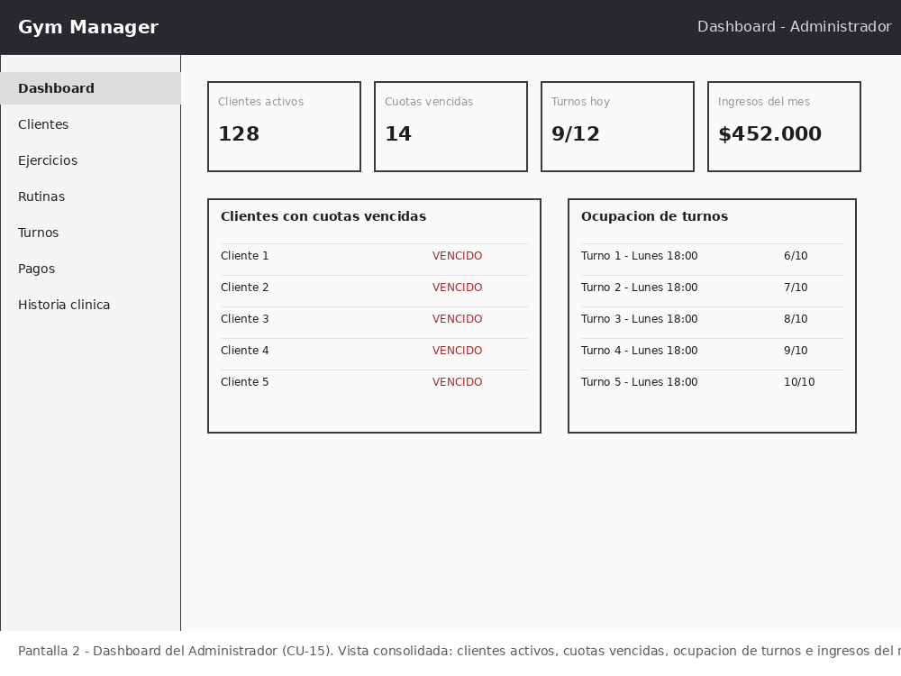
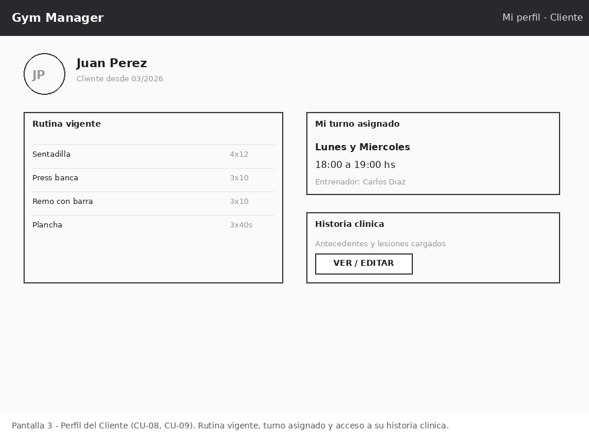
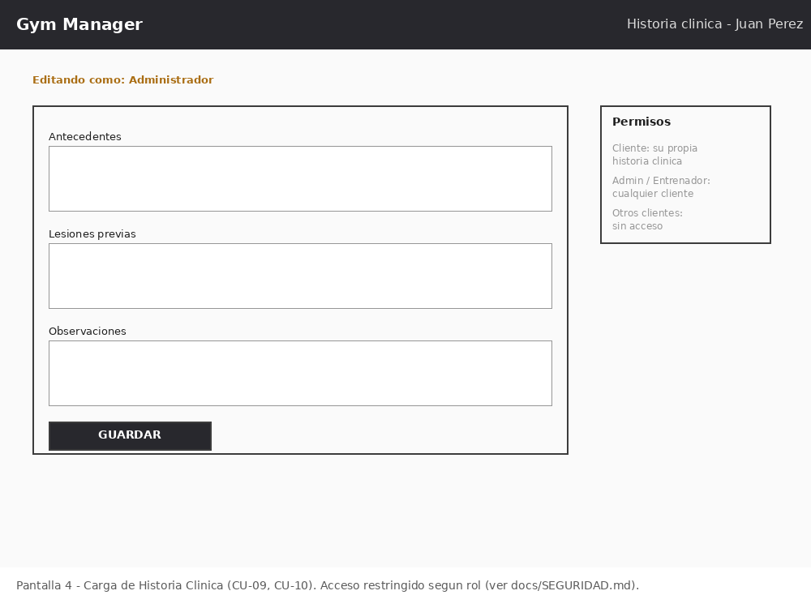
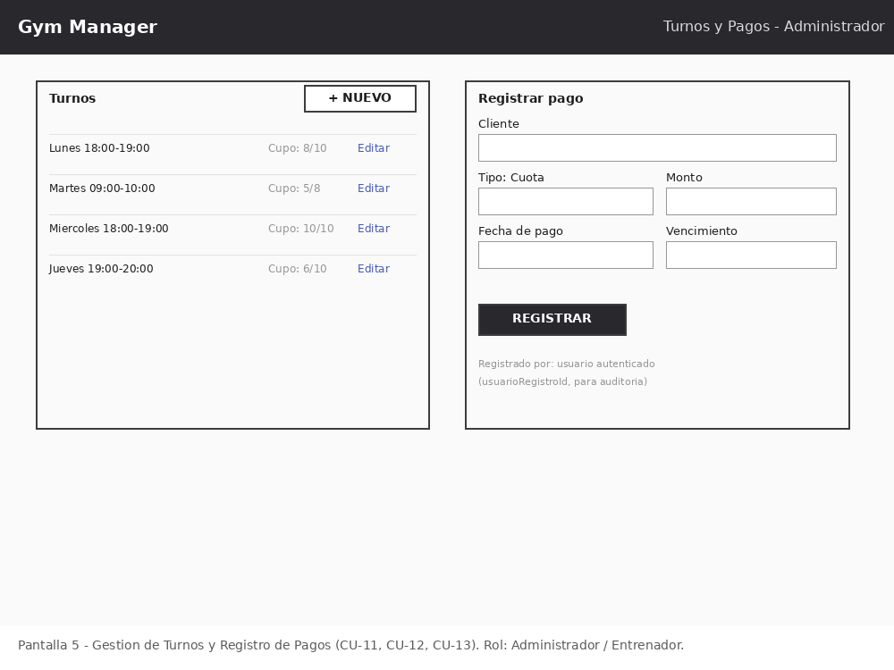

# Mockups — Gym Manager

## Descripción

Mockups de baja fidelidad de las pantallas principales del sistema, pensados para ilustrar la disposición de la información descrita en `MODULOS.md` y `CASOS_DE_USO.md`. Son referencias conceptuales de diseño, no capturas de la interfaz implementada. Los permisos y el alcance del MVP se describen en este texto y en los requisitos.

---

## 1. Inicio de sesión

Pantalla de acceso para las cuentas con ADMIN, ENTRENADOR y/o USUARIO (CU-01). La opción de recuperación mostrada en la imagen pertenece al diseño anterior y queda fuera del MVP. El registro público y el cambio de contraseña autenticado se describen en CU-22 y CU-03.

---

## 2. Dashboard del Administrador

Vista consolidada con los indicadores definidos en el Módulo 8: clientes activos, cuotas vencidas, ocupación de turnos e ingresos del mes (CU-15).

---

## 3. Perfil del Cliente

Vista del cliente con cuenta: su rutina vigente, su turno asignado, y acceso a su historia clínica (CU-08, CU-09).

---

## 4. Historia Clínica

Formulario de carga/edición de historia clínica. El alcance vigente se describe en [SEGURIDAD.md](SEGURIDAD.md) (Cliente: la propia; Administrador/Entrenador: cualquier cliente; otros clientes: sin acceso).

---

## 5. Gestión de Turnos y Pagos

La imagen reúne turnos y pagos como referencia inicial. La implementación utiliza pantallas diferenciadas. ADMIN administra todos los turnos y pagos; ENTRENADOR gestiona sus turnos y carece de acceso a Pagos. Se conserva la auditoría del registro (`usuarioRegistroId`).
